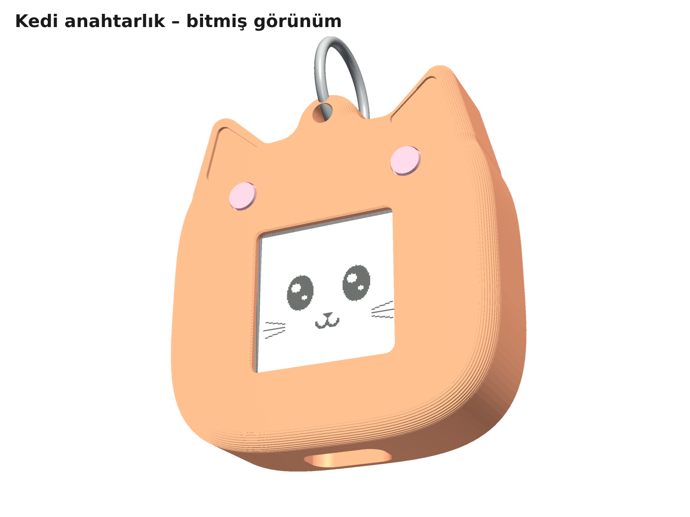
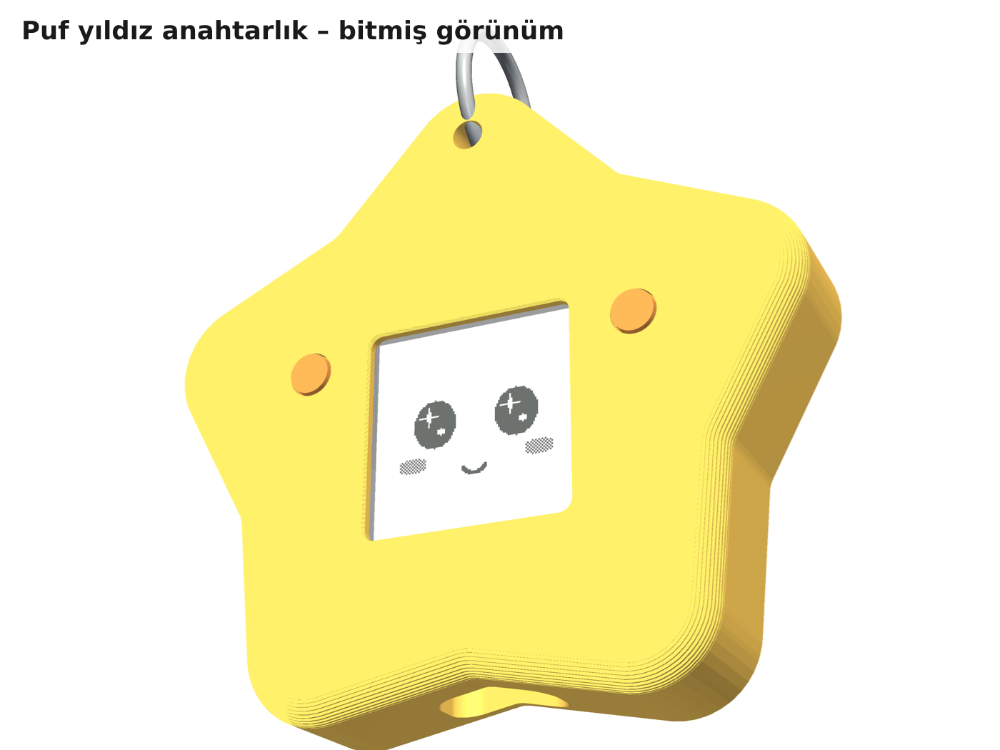
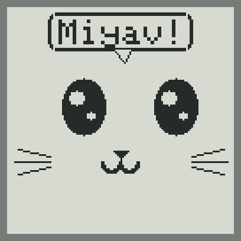
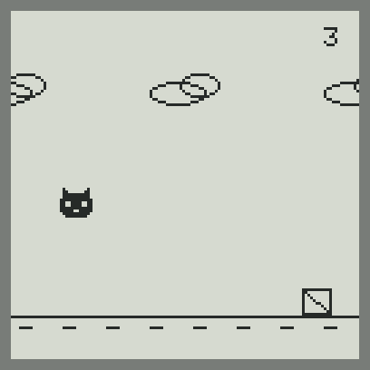
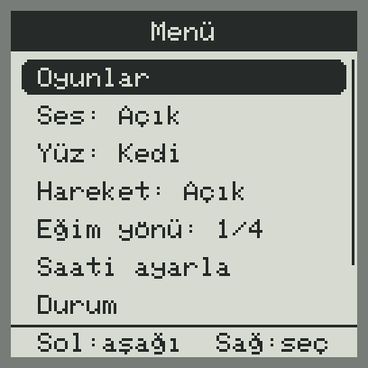
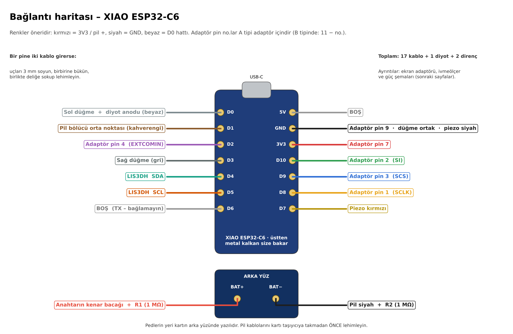

# PocketPal
The keychain buddy to take anywhere!

PocketPal is a small bag keychain with a face that never switches off. A Sharp memory LCD holds the picture at almost
zero power, so the face stays visible while the ESP32-C6 sleeps. Press a button, tap it or shake it and it wakes up,
reacts, talks and plays five mini games. It comes in two shapes, a **cat** and a **puffy star**, that share all the electronics.

| Cat | Puffy star |
|---|---|
|  |  |

> **Türkçe:** Tam yapım kılavuzu Türkçedir: [`docs/Pocket_Pal_Yapim_Kilavuzu.pdf`](docs/Pocket_Pal_Yapim_Kilavuzu.pdf)
> (malzeme listesi, baskı, yazılım yükleme, kablolama, test, montaj, kullanım). Kısa özet: [`BENIOKU.md`](BENIOKU.md).

## At a glance

| | |
|---|---|
| Size | cat 54 × 59 × 15.7 mm · star 73 × 70 × 15.7 mm |
| Screen | Sharp LS013B7DH03, 1.28" 128 × 128 memory LCD, no backlight, readable in daylight |
| Brain | Seeed XIAO ESP32-C6. The low-power (LP) RISC-V core keeps the screen alive during deep sleep |
| Controls | 2 buttons + LIS3DH accelerometer (tap, double tap, shake, tilt) |
| Sound | Passive piezo disc |
| Battery | 250 mAh LiPo (502030). About 2 months per charge with 5 min of play a day (estimate) |
| Parts cost | ≈ 1,870–2,100 TL per unit in Turkey (≈ 1,660–1,890 TL if you order 10+ screens) |
| Build | Hand-wired modules, ~17 wires, no custom PCB. Every part prints in PLA without supports |
| Games | Zıpla (runner), Yakala (catch), Hafıza (memory), Tepki (reaction), Düello (2-player) |

   

## Repository layout

| Path | Contents |
|---|---|
| [`docs/`](docs) | Turkish build guide (PDF), parts list (CSV), and the script that generates the guide |
| [`stl/`](stl) | Print-ready STLs, already oriented for printing, plus a 1:1 template for the clear screen cover |
| [`firmware/`](firmware) | ESP-IDF v5.5 project (C++) and the LP-core program ([details](firmware/README.md)) |
| [`firmware/prebuilt/`](firmware/prebuilt) | Ready-to-flash binaries. `pocketpal_tam.bin` goes at address 0x0 |
| [`cad/`](cad) | Parametric CAD in Python (manifold3d), fit checker, 3D renders, wiring diagrams |
| [`images/`](images) | Renders, wiring diagrams and simulated screen captures used in the guide |
| [`tools/make_package.sh`](tools/make_package.sh) | Regenerates everything and builds `dist/PocketPal_Paket.zip` (the offline Turkish package) |

## Quick start

1. **Order the parts** (list in the guide, chapter 2). Order the screen first; it takes 7–10 working days.
2. **Print** the five files in `stl/` in PLA: 0.2 mm layers, 4 walls, 20 % infill, no supports.
3. **Flash** `firmware/prebuilt/pocketpal_tam.bin` at `0x0` with the browser flasher at
   <https://espressif.github.io/esptool-js/> (Chrome or Edge). If the board doesn't show up, hold **B (BOOT)** while plugging it in.
4. **Wire** it following the guide, chapter 5, and solder the battery last. Then **test** on the bench (chapter 6).
5. **Assemble** it (chapter 7): the inner frame goes into the shell and four M2 × 10 screws close the back.



## Pin map (XIAO ESP32-C6)

| Pin | GPIO | Goes to |
|---|---|---|
| D0 | 0 (LP) | Left button + LIS3DH INT1 through a 1N4148 (deep-sleep wake) |
| D1 | 1 | Battery divider midpoint (2 × 1 MΩ) |
| D2 | 2 (LP) | Screen EXTCOMIN, toggled at 1 Hz by the LP core |
| D3 | 21 | Right button |
| D4 / D5 | 22 / 23 | LIS3DH SDA / SCL |
| D6 | 16 | Unused: it's UART TX and prints at every boot |
| D7 | 17 | Piezo |
| D8 / D9 / D10 | 19 / 20 / 18 | Screen SCLK / SCS / SI |

## Building the firmware

```sh
cd firmware
idf.py set-target esp32c6
idf.py build
idf.py -p <PORT> flash monitor
```

ESP-IDF **v5.5** is required. Arduino isn't used: its prebuilt ESP32-C6 libraries don't enable the LP core.
All tunables (pins, timeouts, night hours, battery thresholds) are in [`firmware/main/config.h`](firmware/main/config.h).
A small desktop simulator in [`firmware/tools/host_sim/`](firmware/tools/host_sim) draws the screens as PNGs.

## Regenerating CAD, images and the guide

```sh
pip install manifold3d trimesh numpy pyvista matplotlib pillow reportlab pypdf
tools/make_package.sh            # STLs, fit check, screens, diagrams, renders, PDF guide, dist/ zip
```

## Status

- The firmware builds cleanly with ESP-IDF v5.5.6. The screen drawings were checked in the simulator. The firmware **hasn't run on real hardware yet**, so keep the serial console open on first power-up.
- The CAD passes an automatic interference check between all parts and module envelopes. A first test print is still to be done.
- Only the screen price was checked; other prices are estimates as of October 2026.

## License

[AGPL-3.0](LICENSE). The 5 × 7 font in `firmware/main/font5x7.h` is derived from the Adafruit GFX library
"classic" font, which is under the BSD license ([`FONT_LICENSE_Adafruit_BSD.txt`](firmware/main/FONT_LICENSE_Adafruit_BSD.txt)).
